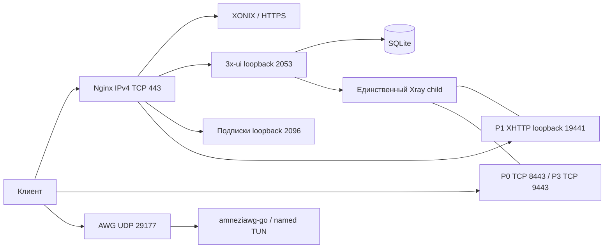
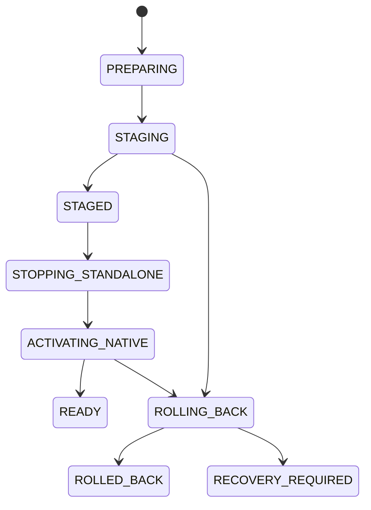

# Архитектура preview

Документ описывает исходники preview, не объявляет шестипротокольную приёмку. Версии и ограничения: [PROJECT_STATUS](PROJECT_STATUS.md), [PROTOCOLS](PROTOCOLS.md).

## Границы компонентов

`install-preview.sh` вызывает `release/preview_install.py`. `bootstrap-preview.sh` получает точный Git commit. `preview_install.py` проверяет Debian/systemd, manifests, binaries и owned state; `preview_two_domain.py` задаёт строгий layout двух имён. `preview_transport.py` и `preview_profiles.py` строят транспортные конфигурации. `preview_panel_inbounds.py` импортирует только P0/P1/P3 через `preview_panel_api.py`.

Панель 3.11.0 владеет клиентами и assignments в `/var/lib/3xui-pro-fork/x-ui.db`. Unit задаёт `XUI_DB_FOLDER`; не следует искать database по стандартному upstream пути `/etc/x-ui`.

P1: Nginx TLS/H2 → cleartext H2 loopback 19441. Native external proxy metadata публикует клиентам корректные domain:443, TLS/SNI/ALPN. P0 и P3 идут непосредственно в Xray через фиксированные public TCP порты. REALITY destination — отдельный local TLS/H2 endpoint 19444 с ответом 404. Третий домен и PROXY headers не требуются.

AWG 3.1 — отдельный `3xui-pro-fork-awg.service`, supervisor `awg_service.py`, interface `xproawg0`. Он создаёт эксклюзивный named TUN, передаёт descriptor закреплённому amneziawg-go, применяет `server.setconf` через `awg setconf`. Не подключается к существующему интерфейсу и не удаляет его по имени. Сложные FD_NATIVE namespace эксперименты из исторической ветки в этот production runtime не перенесены.

WireGuard и Hysteria2 отсутствуют в current installer lifecycle. Наличие старого генератора или upstream имени протокола не обеспечивает UI/backend/client management. Архитектурное расширение должно связать SQLite/API, runtime, peer lifecycle и export; декоративные строки недопустимы.

Optional `preview_vpn_inbounds.py` PREVIEW-08 отделён от installer: read-only plan проверяет native READY и actual UDP owners; apply ограничен disposable lab/RFC1918 и специальным marker. Explicit lab AWG handoff освобождает29177 перед embedded activation. Новый private manifest `preview-vpn-inbounds.json` отделён от existing native READY и отмечает `CONFIGURED_NOT_ACCEPTED` до реального traffic acceptance. Ошибка даёт `RECOVERY_REQUIRED`, не автоматический restore старой DB. Сверяйте final evidence для фактически проверенного результата utility.

## Владение и источники истины

| Данные | Владелец и источник истины |
|---|---|
| VLESS inbound, clients, subscriptions | Native panel API + SQLite |
| Runtime users | Xray API/живой трафик; generated config может отставать от gRPC изменений |
| Fixed ingress identity | Owned state + проверенные panel settings; повтор installer отказывает при несовпадении |
| AWG keys/peer | Private `/var/lib/3xui-pro-fork/awg/` |
| Web/layout | Private `preview-web.json`, managed Nginx files |
| Panel setup credential | Private `preview-panel.json`; не публиковать содержимое |
| Migration ownership | Private `preview-panel-inbounds.json` |
| TLS | Isolated Certbot config/work/log под `/var/lib/3xui-preview-acme` |
| XONIX | `assets/decoy/xonix/index.html`; high score в localStorage браузера |

После READY `preview-xray.json` и `preview-xray-clients.json` — сохранённые pre-migration snapshots, не текущие экспорты клиентов. Не редактировать их для управления клиентами.

## Миграция

Это иллюстрация нормального handoff и известных failure paths, не полный формальный автомат. Неоднозначное состояние на любом шаге требует ручной диагностики. Сначала staged inbound disabled, затем освобождение портов standalone, затем активация native. READY устанавливается после проверок владельцев listeners, keys, clients и транспорта. Автоматического перехода READY → rollback нет.

Systemd supervises panel, AWG, Nginx и renewal timer. Standalone `3xui-preview-xray.service` после native handoff inactive/disabled. Два процесса не должны владеть одинаковыми endpoint. Все изменения ownership требуют сохранения ключей и отдельно проверенного плана.
