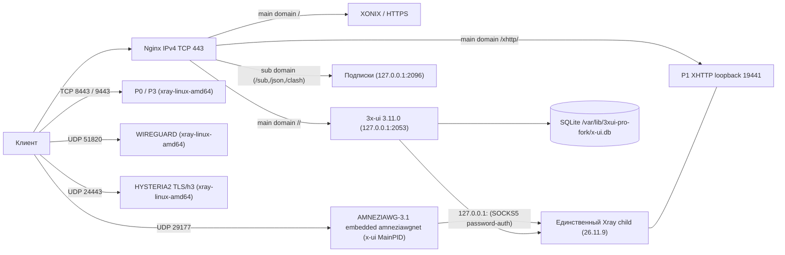
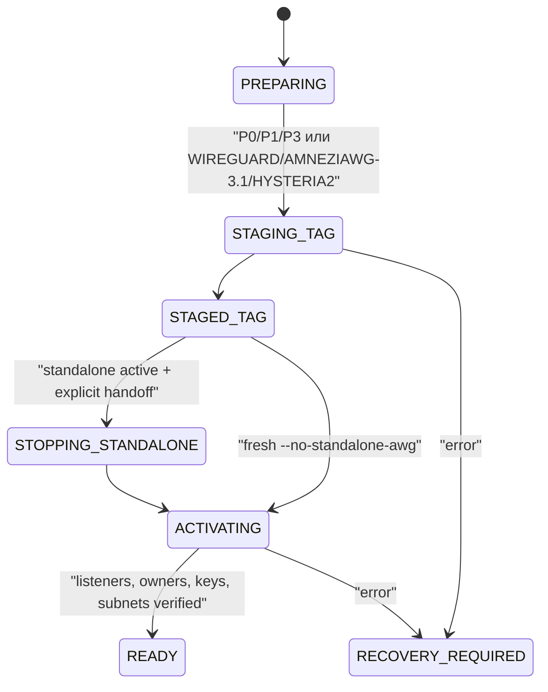

# Архитектура preview

Документ описывает завершённую шестипротокольную архитектуру Debian 13 preview (`PREVIEW-XONIX-08`). Сведения о статусе и ограничениях: [PROJECT_STATUS](PROJECT_STATUS.md), решения: [DECISIONS](DECISIONS.md), протокольные контракты: [PROTOCOLS](PROTOCOLS.md).

## Границы компонентов и runtime ownership

- **Bootstrap и orchestration**: [bootstrap-preview.sh](../bootstrap-preview.sh) загружает и проверяет точный 40-hex Git commit; [install-preview.sh](../install-preview.sh) вызывает [preview_install.py](../release/preview_install.py).
- **Web, ACME и VLESS transport layout**: [preview_two_domain.py](../release/preview_two_domain.py) формирует строгий two-domain layout (`main` + `subscription`); [preview_acme.py](../release/preview_acme.py) выпускает и обновляет SAN-сертификат в `/var/lib/3xui-preview-acme`; [preview_transport.py](../release/preview_transport.py) готовит pre-migration baseline P0/P1/P3 (loopback `19444` используется как fallback/cover для REALITY).
- **Candidate installation и file ownership**: [install_candidate.py](../release/install_candidate.py) проверяет Debian 13 amd64 / systemd / SHA256 pinned binaries и раскладывает бинарники в `/opt/3xui-pro-fork`. В 6-inbound режиме передаётся `--no-standalone-awg`: `3xui-pro-fork-awg.service` копируется и остаётся disabled/inactive, а `/30` standalone-конфигурация в `/var/lib/3xui-pro-fork/awg/` не создаётся (режим `--vless-only` сохраняет прежнюю standalone-схему). [upgrade_candidate.py](../release/upgrade_candidate.py) проверяет SHA256 pinned-компонентов, unit-файлов и фактических `/proc/<pid>/exe`.
- **Native P0/P1/P3 provisioning**: [preview_panel_inbounds.py](../release/preview_panel_inbounds.py) через [preview_panel_api.py](../release/preview_panel_api.py) импортирует `VLESS-REALITY-XHTTP-H2` (TCP `8443`), `VLESS-TLS-XHTTP-H2` (`127.0.0.1:19441` за Nginx `443`) и `VLESS-REALITY-VISION` (TCP `9443`), сохраняя состояние в root-only журнале `preview-panel-inbounds.json` и останавливая standalone `3xui-preview-xray.service`.
- **Шестипротокольная VPN-оркестрация**: [preview_vpn_inbounds.py](../release/preview_vpn_inbounds.py) объединяет три полностью независимых протокольных модуля:
  - [preview_wireguard.py](../release/preview_wireguard.py) — обычный WireGuard (`WIREGUARD`, UDP `51820`, `noKernelTun: true`, pure-Python RFC 7748 X25519, владелец UDP-сокета `xray-linux-amd64`);
  - [preview_amneziawg31.py](../release/preview_amneziawg31.py) — AmneziaWG 3.1 (`AMNEZIAWG-3.1`, UDP `29177`, `kernelMode: false`, embedded `amneziawgnet` внутри `x-ui` MainPID, ретрансляция в Xray через loopback password-auth SOCKS5 inbound `127.0.0.1:<port>`);
  - [preview_hysteria2.py](../release/preview_hysteria2.py) — Hysteria2 v2 (`HYSTERIA2`, UDP `24443`, `network: hysteria`, TLS `h3` с переиспользованием existing two-domain ACME-сертификата, владелец UDP-сокета `xray-linux-amd64`).

| Inbound tag | Протокол | Порт / bind по умолчанию | Владелец сокета | Подсеть / транспорт |
|---|---|---|---|---|
| `VLESS-REALITY-XHTTP-H2` | `vless` | TCP `8443` (`--p0-port`) | `xray-linux-amd64` | REALITY + XHTTP H2 |
| `VLESS-TLS-XHTTP-H2` | `vless` | Public TCP `443` → `127.0.0.1:19441` | `nginx` → `xray-linux-amd64` | Let's Encrypt TLS + H2 `externalProxy` |
| `VLESS-REALITY-VISION` | `vless` | TCP `9443` (`--p3-port`) | `xray-linux-amd64` | raw/`tcp` REALITY Vision |
| `WIREGUARD` | `wireguard` | UDP `51820` (`--wg-port`) | `xray-linux-amd64` | RFC1918 `10.89.8.0/24` (`--wg-subnet`), `noKernelTun: true`, MTU `1420` |
| `AMNEZIAWG-3.1` | `amneziawg` | UDP `29177` (`--awg-port`) | `x-ui` MainPID → Xray SOCKS5 | RFC1918 `10.88.32.0/24` (`--awg-subnet`), `kernelMode: false`, HPK + AWG 3.1 obfuscation, MTU `1420` |
| `HYSTERIA2` | `hysteria` | UDP `24443` (`--hy2-port`) | `xray-linux-amd64` | v2 QUIC/TLS ALPN `h3`, two-domain ACME cert |

## Источники истины и разделение режимов

| Артефакт / данные | Владелец и назначение |
|---|---|
| `/var/lib/3xui-pro-fork/x-ui.db` | Единственный источник истины SQLite (`XUI_DB_FOLDER`) для всех 6 inbounds, клиентов и подписок |
| Live Xray core (`/opt/3xui-pro-fork/panel/bin/config.json` + gRPC API) | Активные inbounds/users в runtime; для `AMNEZIAWG-3.1` пересоздание Xray SOCKS5-аккаунтов происходит на ~30-секундном reconcile-тике |
| `/var/lib/3xui-pro-fork/preview-web.json`, Nginx include | Owned web/two-domain layout и ACME metadata |
| `/var/lib/3xui-pro-fork/preview-panel.json` | Root-only setup/credential state (не публиковать) |
| `/var/lib/3xui-pro-fork/preview-panel-inbounds.json` | Fail-closed журнал native P0/P1/P3 migration (`phase: READY`) |
| `/var/lib/3xui-pro-fork/preview-vpn-inbounds.json` | Fail-closed журнал 6-inbound VPN provisioning (`version: 2`, `phase: READY`) |
| `/var/lib/3xui-pro-fork/awg/` | Архивная конфигурация standalone `3xui-pro-fork-awg.service` (`--vless-only` или сохранённый pre-handoff архив на `de126`) |
| `/var/lib/3xui-preview-acme/` | Изолированный Certbot config/work/log для SAN-сертификата двух доменов |
| `assets/decoy/xonix/index.html` | Статический decoy XONIX (`/` основного домена, high score в browser `localStorage`) |

После `READY` файлы `preview-xray.json` и `preview-xray-clients.json` служат только pre-migration snapshots для диагностики/recovery.

## State machine двух журналов миграции

Оба журнала (`preview-panel-inbounds.json` и `preview-vpn-inbounds.json`) работают по принципу fail-closed: после достижения `READY` автоматический rollback или повторное усыновление запрещены, а `RECOVERY_REQUIRED` требует ручной диагностики с сохранением backups ([RECOVERY](RECOVERY.md)).

**Production vs Lab**: production VPS `de126` (`179.254.154.126`) переведён 2026-11-24 в 6-inbound конфигурацию с ревизии `9e44b525685458f00c34effe6795814b1da24da9` штатным `--panel-inbounds --add-vpn-inbounds --handoff-standalone-awg` ([PRODUCTION_ROLLOUT_6_INBOUNDS](PRODUCTION_ROLLOUT_6_INBOUNDS.md)); оба журнала в `READY`, прежний `/var/lib/3xui-pro-fork/awg/` и backup сохранены, `3xui-pro-fork-awg.service` `inactive`/`disabled`. Автоматические мутации без отдельного разрешения для будущих задач запрещены.
